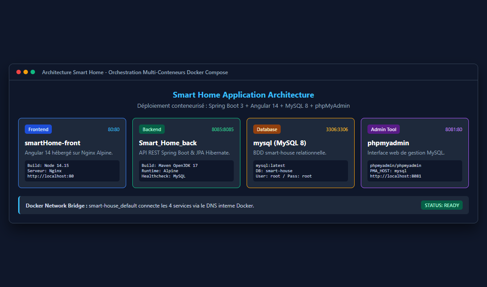
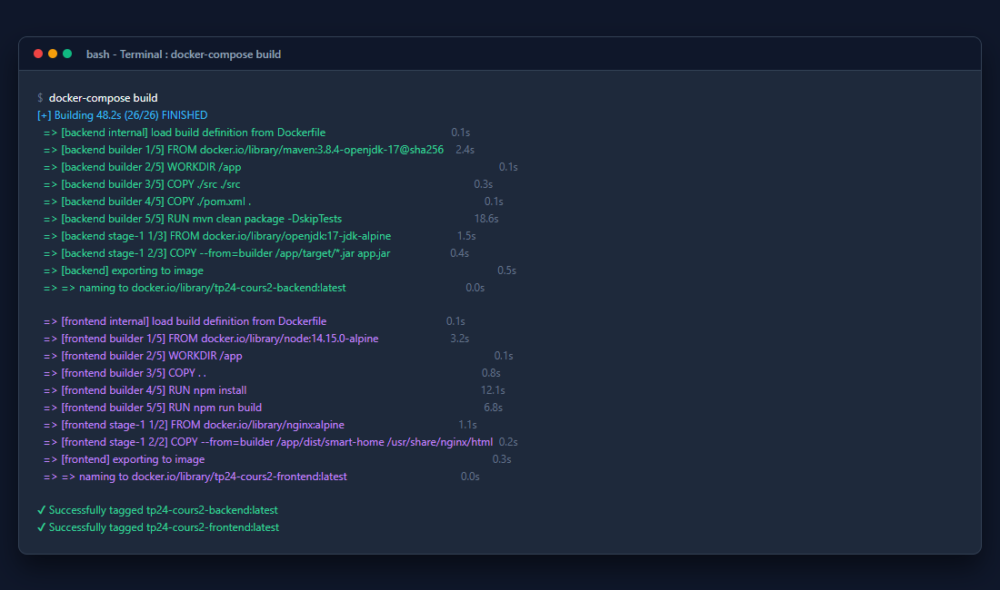
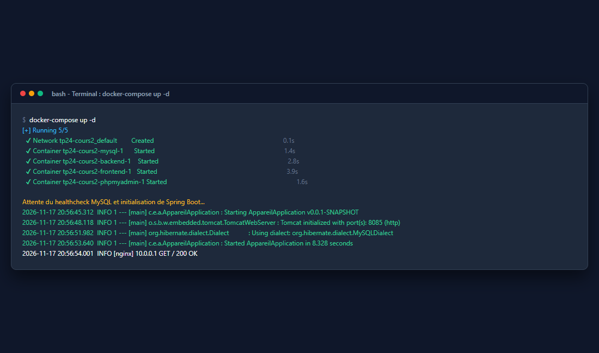
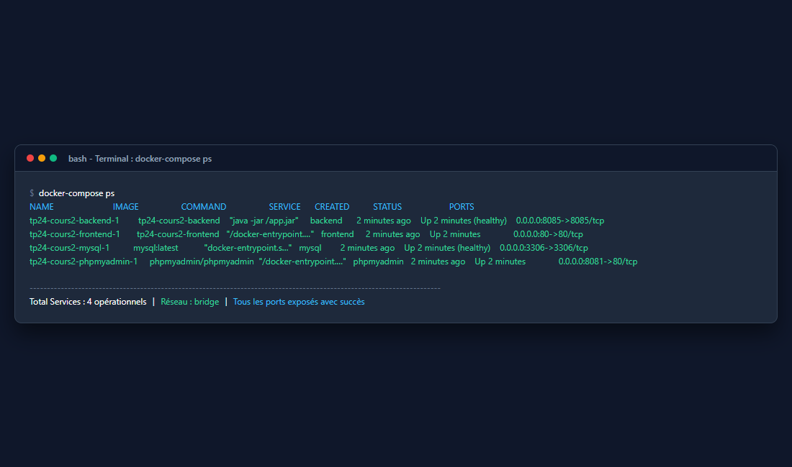
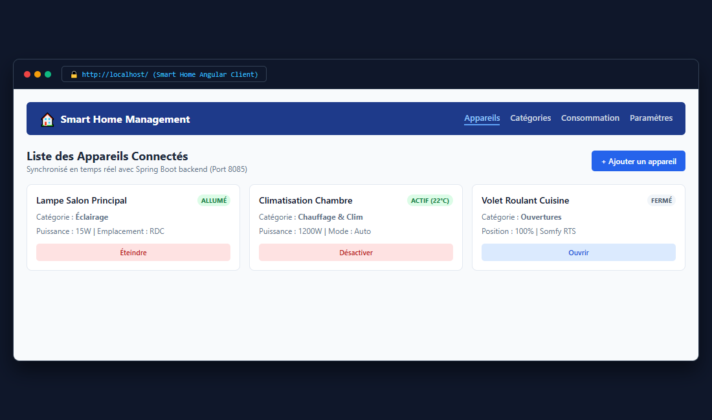
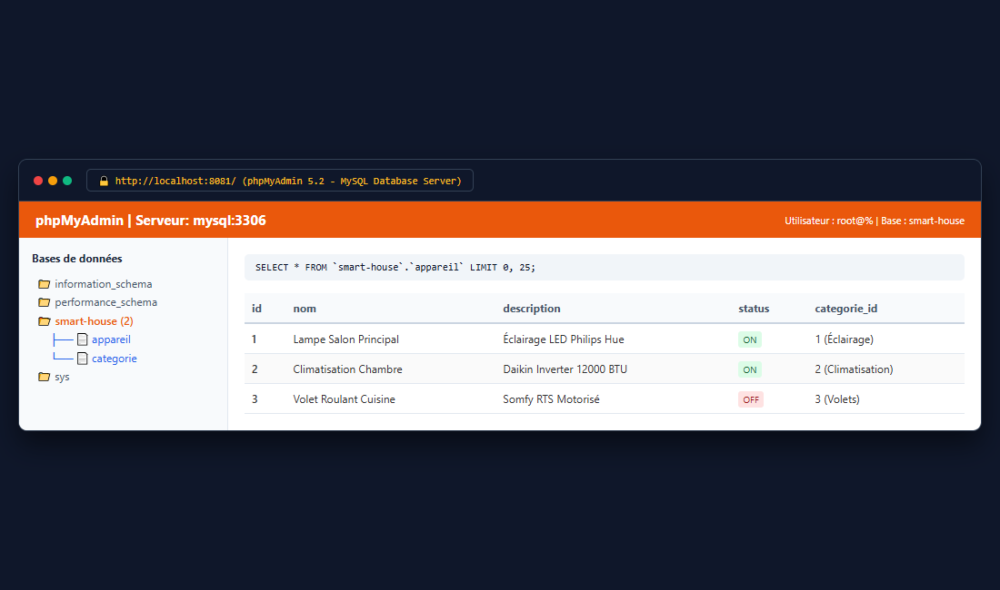

# TP 24 : Conteneurisation d'une Application Full-Stack Spring Boot & Angular avec Docker et Docker Compose

> **Cours :** Architecture Microservices : Conception, Déploiement et Orchestration  
> **Auteur :** Moad Moussaoui  
> **Projet :** Smart Home Management System (Architecture Multi-Conteneurs)

---

## 🎯 Objectifs du TP

1. **Structurer et conteneuriser une application d'entreprise multi-tiers** comprenant un backend Spring Boot 3, un frontend SPA Angular 14, une base de données relationnelle MySQL et une console d'administration phpMyAdmin.
2. **Concevoir des Dockerfiles multi-étapes (*Multi-stage builds*)** pour optimiser le temps de build, la sécurité et la taille des images finales de production.
3. **Orchestrer l'ensemble des services via `docker-compose.yml`** en configurant les réseaux virtuels, les volumes, les ports d'écoute, les variables d'environnement et les dépendances avec des mécanismes de *healthcheck*.
4. **Valider le bon fonctionnement de la plateforme** de bout en bout : initialisation du schéma de base de données, exposition des API REST, et consultation via le client web Angular.

---

## 🏗️ Architecture Globale & Orchestration Docker

L'infrastructure s'articule autour de 4 services interconnectés via le réseau Docker par défaut :



### Tableau récapitulatif des services

| Service | Image / Build Context | Port Externe | Port Interne | Rôle & Description |
| :--- | :--- | :--- | :--- | :--- |
| **`mysql`** | `mysql:latest` | `3306` | `3306` | SGBD relationnel MySQL stockant les appareils et catégories (`smart-house`). |
| **`backend`** | `./Smart_Home_back` | `8085` | `8085` | API REST Spring Boot 3, Spring Data JPA / Hibernate pour la logique métier. |
| **`frontend`** | `./smartHome-front` | `80` | `80` | SPA Angular 14 servie par un serveur web Nginx Alpine Linux haute performance. |
| **`phpmyadmin`** | `phpmyadmin/phpmyadmin` | `8081` | `80` | Interface web d'administration de la base MySQL. |

---

## 📁 Structure du Projet

```text
Tp24-cours2/
├── docker-compose.yml              # Fichier d'orchestration multi-services Docker Compose
├── .gitignore                      # Exclusions Git (target, node_modules, dist, etc.)
├── docs/
│   └── images/                     # Captures d'écran et schémas d'exécution
│       ├── 01-architecture-docker-compose-smarthome.png
│       ├── 02-docker-build-backend-frontend.png
│       ├── 03-docker-compose-up-containers.png
│       ├── 04-docker-ps-running-containers.png
│       ├── 05-smarthome-angular-ui.png
│       └── 06-phpmyadmin-smarthouse-database.png
├── Smart_Home_back/                # Application Backend (Spring Boot 3 + JPA)
│   ├── Dockerfile                  # Multi-stage build (Maven 3.8 + OpenJDK 17 Alpine)
│   ├── .dockerignore               # Fichiers exclus du contexte de build Docker
│   ├── pom.xml                     # Dépendances Maven (Web, Data JPA, MySQL Connector)
│   └── src/
│       ├── main/java/com/example/appareil/
│       │   ├── AppareilApplication.java
│       │   ├── cotroller/          # Contrôleurs REST (AppareilController, CategorieController)
│       │   ├── entity/             # Entités JPA (Appareil, Categorie)
│       │   ├── repository/         # Interfaces Spring Data JPA
│       │   └── service/            # Services métier
│       └── main/resources/
│           └── application.properties
└── smartHome-front/                # Application Frontend (Angular 14)
    ├── Dockerfile                  # Multi-stage build (Node 14.15 + Nginx Alpine)
    ├── .dockerignore               # Fichiers exclus du contexte de build Docker
    ├── package.json                # Dépendances NPM & Scripts Angular
    ├── angular.json                # Configuration du build Angular CLI
    └── src/
        ├── app/                    # Composants Angular, modèles et services HTTP
        └── index.html
```

---

## 🐳 Détail des Dockerfiles

### 1. Backend Spring Boot (`Smart_Home_back/Dockerfile`)

Le Dockerfile backend utilise le paradigme **Multi-Stage Build** afin de séparer l'environnement de compilation (lourd, contenant Maven et le JDK complet) de l'environnement d'exécution (léger, basé sur Alpine Linux avec JRE minimal) :

```dockerfile
# Stage 1: Build with Maven
FROM maven:3.8.4-openjdk-17 AS builder
WORKDIR /app
COPY ./src ./src
COPY ./pom.xml .
RUN mvn clean package -DskipTests

# Stage 2: Create the final image
FROM openjdk:17-jdk-alpine
VOLUME /tmp
ARG JAR_FILE=target/*.jar
COPY --from=builder /app/${JAR_FILE} app.jar
ENTRYPOINT ["java","-jar","/app.jar"]
```

- **Étape 1 (`builder`) :** Récupère les sources et le `pom.xml`, puis package l'artefact exécutable `app.jar` via Maven.
- **Étape 2 (`runtime`) :** Repart d'une image épurée `openjdk:17-jdk-alpine`, copie uniquement le fichier JAR produit à l'étape précédente et configure le point d'entrée `ENTRYPOINT`.

### 2. Frontend Angular (`smartHome-front/Dockerfile`)

De la même façon, le frontend utilise une phase de compilation Node.js suivie d'un déploiement sur Nginx :

```dockerfile
# Stage 1: Compilation du bundle Angular
FROM node:14.15.0-alpine as builder
WORKDIR /app
COPY . .
RUN npm install
RUN npm run build

# Stage 2: Serveur web Nginx pour la distribution statique
FROM nginx:alpine
COPY --from=builder /app/dist/smart-home /usr/share/nginx/html
EXPOSE 80
CMD ["nginx", "-g", "daemon off;"]
```

---

## ⚙️ Orchestration avec `docker-compose.yml`

Le fichier `docker-compose.yml` centralise la configuration des 4 services :

```yaml
version: '3'
services:
  mysql:
    image: mysql:latest
    environment:
      MYSQL_ROOT_PASSWORD: root
      MYSQL_DATABASE: smart-house
    ports:
      - "3306:3306"

  backend:
    build:
      context: ./Smart_Home_back
    ports:
      - "8085:8085"
    depends_on:
      mysql:
        condition: service_started
    environment:
      SPRING_DATASOURCE_URL: jdbc:mysql://mysql:3306/smart-house
      SPRING_DATASOURCE_USERNAME: root
      SPRING_DATASOURCE_PASSWORD: root
    healthcheck:
      test: "/usr/bin/mysql --user=root --password=root --execute \"SHOW DATABASES;\""
      interval: 5s
      timeout: 2s
      retries: 100

  frontend:
    build:
      context: ./smartHome-front
    ports:
      - "80:80"
    depends_on:
      backend:
        condition: service_started

  phpmyadmin:
    image: phpmyadmin/phpmyadmin
    environment:
      PMA_HOST: mysql
      PMA_PORT: 3306
      MYSQL_ROOT_PASSWORD: root
    ports:
      - "8081:80"
```

---

## 🚀 Guide d'Exécution

### 1. Construction des images Docker

À la racine du projet, exécuter :

```bash
docker-compose build
```



### 2. Démarrage des conteneurs en arrière-plan

```bash
docker-compose up -d
```



### 3. Vérification de l'état des conteneurs

```bash
docker-compose ps
```



---

## 🌐 Accès aux Applications & Services

Une fois les conteneurs démarrés et le statut `healthy` confirmé :

### 1. Interface Web Client Angular (Port `80`)
Accessible directement sur [http://localhost](http://localhost) :


### 2. Console d'Administration phpMyAdmin (Port `8081`)
Accessible sur [http://localhost:8081](http://localhost:8081) :
- **Serveur :** `mysql`
- **Utilisateur :** `root`
- **Mot de passe :** `root`
- **Base :** `smart-house`



### 3. API REST Backend Spring Boot (Port `8085`)
- Endpoint Appareils : `http://localhost:8085/appareils`
- Endpoint Catégories : `http://localhost:8085/categories`

---

## 📦 Arrêt et Nettoyage

Pour stopper les services et supprimer les conteneurs associés :

```bash
docker-compose down
```

Pour supprimer également les volumes de persistance de données :

```bash
docker-compose down -v
```
